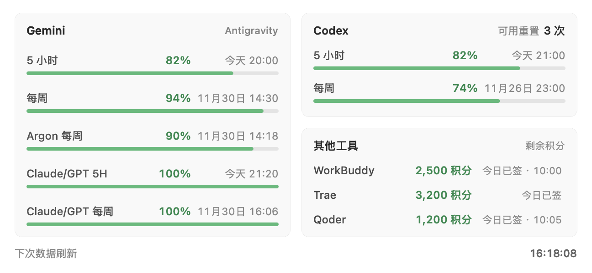

# Codex Usage Status

轻量级 macOS 原生菜单栏 AI 额度看板，用于一目了然地查看 **Codex（GPT）**、**Gemini / Antigravity** 以及 **WorkBuddy / Trae / Qoder** 等本地工具的剩余额度、重置时间与签到状态。

> 本项目为社区开源工具，与 OpenAI、Google 及各第三方厂商无官方关联。  
> 完整更新日志：[CHANGELOG.md](CHANGELOG.md) ｜ [English](#english)



*以上为使用虚构示例数据渲染的实机界面效果图，不含任何真实账号数据。*

---

## 核心特性（中文说明）

- **双栏白底悬浮弹窗**：鼠标停留在菜单栏图标约 `0.2s` 自动展开：
  - **左栏（Gemini · Antigravity）**：支持最多 5 条配额桶（`5 小时`、`每周`、`Argon 每周`、`Claude/GPT 5H`、`Claude/GPT 每周`），带语义色进度条、表格式对齐百分比与重置时间；
  - **右栏上区（Codex）**：展示可用重置次数（`availableCount`）、`5 小时` 与 `每周` 剩余百分比进度条及重置时间；
  - **右栏下区（其他工具）**：以三列对齐方式展示 **WorkBuddy / Trae / Qoder** 剩余积分与今日签到状态；
  - **底部通栏**：展示下次后台自动刷新时间。
- **三种菜单栏图标样式**：点击菜单栏图标 → **Display Style** 可自由切换：
  - **Compact Ring (7D)**（`30pt` 宽紧凑单环，专为刘海屏右侧菜单栏优化，不易被遮挡）；
  - **Double Ring**（5H / 7D 双圆环）；
  - **Large Readout**（大字百分比读数）。
- **多宿主自动启停联动（可选）**：安装本地 `quota-lifecycle` 守护进程后，默认监听本机已安装的 `ChatGPT.app`、`Gemini.app`、`Antigravity.app`——**任意一个在运行即保持显示，三者全部退出后自动关闭**。
- **隐私与安全边界**（详见 [PRIVACY.md](PRIVACY.md) 与 [SECURITY.md](SECURITY.md)）：
  - Codex 数据仅通过官方本地 `codex app-server` 的 `account/rateLimits/read` 方法读取；
  - 应用本身不读取任何凭据文件、Keychain、浏览器 Cookie 或 OAuth Token，不修改官方应用包，也不上传任何遥测数据。

## 环境要求

- macOS 13 或更高版本
- 已安装 ChatGPT 桌面端（`/Applications/ChatGPT.app`）或独立版 Codex（`/Applications/Codex.app`）
- 从源码构建或安装联动助手需 Xcode Command Line Tools（Swift）、Node.js 20+ 与 Python 3

## 从源码构建与安装

```sh
git clone https://github.com/Serendipity-Y/codex-usage-status.git
cd codex-usage-status
npm run install:macos
```

常用开发与校验命令：

```sh
npm test
swift test --package-path macos/CodexUsageStatus
npm run build:macos
```

## 可选：多宿主自动启停联动（ChatGPT / Gemini / Antigravity）

安装后将在登录时后台运行轻量监听进程，只在指定应用运行时显示菜单栏圆环：

```sh
python3 lifecycle/install.py install
python3 lifecycle/install.py check
```

如需自定义监听应用路径（可重复传入 `--host-app`）：

```sh
python3 lifecycle/install.py install \
  --host-app "/Applications/ChatGPT.app" \
  --host-app "/Applications/Gemini.app" \
  --host-app "/Applications/Antigravity.app" \
  --quota-app "/Applications/CodexUsageStatus.app" \
  --codex-bin "/path/to/codex"
```

停用联动监听：`python3 lifecycle/install.py disable`。

## 可选：接入 Gemini 与其他工具数据源

悬浮窗左栏（Gemini）与右栏下区（WorkBuddy / Trae / Qoder）支持通过用户自主配置的本地数据源并发独立刷新，解析优先级如下：

1. 环境变量 `GEMINI_QUOTA_COMMAND`（指向本机可执行脚本，stdout 输出 JSON）
2. 环境变量 `GEMINI_QUOTA_FILE`（指向本机 JSON 文件）
3. 默认本地快照文件：`~/Library/Application Support/CodexUsageStatus/gemini-quota.json`
4. 默认本地采集脚本：`~/Library/Application Support/CodexUsageStatus/bin/fetch-gemini-quota.py`

JSON 数据协议示例：

```json
{
  "plan": "Antigravity",
  "buckets": [
    { "id": "gemini-5h", "label": "5 小时", "remainingPercent": 82, "resetsAt": 1795435200 }
  ],
  "extraProviders": [
    { "id": "workbuddy", "name": "WorkBuddy", "valueText": "2,500 积分", "statusText": "今日已签 · 10:00" }
  ]
}
```

## 常见问题排查

- **菜单栏看不到图标**：本应用为纯菜单栏应用（无 Dock 图标）。如使用刘海屏 MacBook 且右侧图标较多，可切换到 `Compact Ring (7D)` 紧凑单环模式，或按住 `⌘` 将图标拖至更靠右位置。
- **刷新失败显示问号**：悬浮卡片会保留上次成功的数据并提示失败原因与重试时间（失败退避 `60s / 120s / 300s`）。查看本机诊断日志：
  ```sh
  /usr/bin/log show --last 30m --style compact --predicate 'subsystem == "io.github.codexusagestatus" AND category == "refresh"'
  ```

---

## English

An unofficial native macOS menu-bar companion for viewing **Codex**, **Gemini / Antigravity**, and optional external tool balances (**WorkBuddy / Trae / Qoder**) at a glance.

- **Two-column hover card**: Left column shows up to 5 Gemini / Antigravity quota buckets with progress bars and reset times; right column shows Codex 5-hour / weekly windows (with available reset count) and tabular credit balances for WorkBuddy / Trae / Qoder.
- **Display styles**: Switch between **Compact Ring (7D)** (`30pt` notch-friendly single ring), **Double Ring**, and **Large Readout**.
- **Privacy & safety**: Codex usage comes exclusively from local `codex app-server` (`account/rateLimits/read`). The app itself never reads credential files, browser cookies, Keychain items, or OAuth tokens. See [PRIVACY.md](PRIVACY.md) and [SECURITY.md](SECURITY.md).
- **Multi-host lifecycle helper**: Optional per-user listener (`lifecycle/install.py`) keeps the badge running while any configured host app (`ChatGPT.app`, `Gemini.app`, `Antigravity.app`) is active and quits cleanly once all exit.
- **Build & test**:
  ```sh
  npm test
  swift test --package-path macos/CodexUsageStatus
  npm run build:macos
  ```
- **Downloads & releases**: Pre-built ad-hoc signed ZIPs (`arm64` / `x86_64`) are published on [GitHub Releases](https://github.com/Serendipity-Y/codex-usage-status/releases). See [CHANGELOG.md](CHANGELOG.md) for version history.
